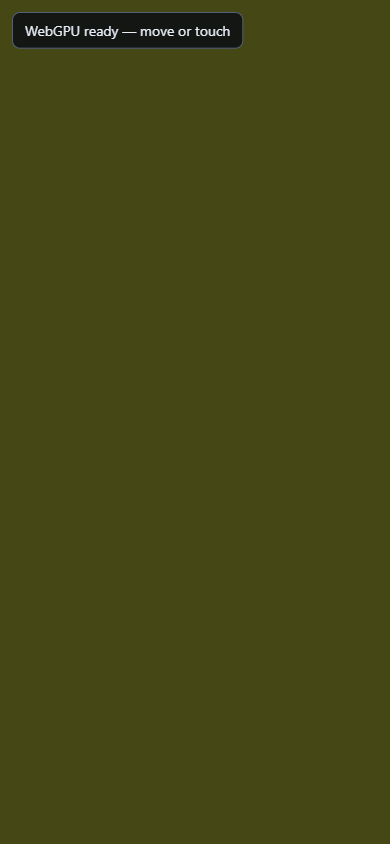

<a name="english"></a>

<h2 align="center">Krinik-Retribution</h2>

<p align="center"><b>A modern browser-based reimagining of Silent Storm</b><br>
C++ · WebAssembly · WebGPU · Desktop and touch input</p>

<p align="center">
  <a href="#english"></a>
  &nbsp;
  <a href="#russian"></a>
</p>

<p align="center">
  <a href="LICENSE"></a>
  
  
  <a href="https://github.com/MikalaiKryvusha/KAIF"></a>
</p>

[Читать по-русски →](#russian)

Krinik-Retribution brings the tactical world of Silent Storm to modern browsers. The technology path is C++,
compiled to WebAssembly through Emscripten and rendered through WebGPU. The target experience runs on a PC,
Steam Deck, Android phone or MacBook through the browser, without a separate installation.

<p align="center">
  
</p>

### Current state

The repository contains a working technical vertical slice. C++ code builds for native Windows and WebAssembly;
WebGPU presents frames; mouse and touch input reach the platform-independent core; desktop and touch-sized
viewports are exercised by a real Chromium run. Full gameplay and missions are planned in the
[roadmap](MASTER_PLAN.md). The current state is recorded in [STATUS.md](STATUS.md).

### Build and run

The current Windows toolchain is registered in `tools/toolchain.mjs`. Check it before building:

```bash
npm run doctor
npm run test:native
npm run build:web
```

Serve the generated page:

```bash
python -m http.server --directory build/web 8000
```

Open `http://localhost:8000`. A browser with WebGPU is required.

Run the browser verification in Git Bash:

```bash
KR_BROWSER_HEADED=1 npm run test:browser
```

The headed run is used on Windows when headless Chromium cannot provide a WebGPU adapter. The test reads the
console, exercises mouse and touch input, and saves a screenshot in `testcases/reports/`.

### Project map

| Path | What lives there |
|---|---|
| `core/` | platform-independent C++ state and behavior |
| `platform/web/` | Emscripten, input and the WebGPU frame path |
| `web/` | the HTML canvas shell |
| `tests/` | Catch2 and Playwright verification |
| `tools/` | toolchain, build, Kimi hooks and voice integration |
| `design/` | the KUIPS screen-flow workspace |
| `researches/` | source-tree and tooling evidence |

### Sources and licence

The new project code is licensed under [MIT](LICENSE). Silent Storm belongs to Nival. Original game assets and
third-party source trees keep their own licences and are not relicensed by this repository. The native reference
checkouts are separate repositories and are not distributed as part of Krinik-Retribution.

Author: Mikalai Kryvusha (Krinik). Development method: KAIF and Superpowers, adapted for Kimi Code.

---

<a name="russian"></a>

<h2 align="center">Krinik-Retribution</h2>

<p align="center"><b>Современное переосмысление Silent Storm в браузере</b><br>
C++ · WebAssembly · WebGPU · Ввод мышью и касаниями</p>

<p align="center">
  <a href="#english"></a>
  &nbsp;
  <a href="#russian"></a>
</p>

<p align="center">
  <a href="LICENSE"></a>
  
  
  <a href="https://github.com/MikalaiKryvusha/KAIF"></a>
</p>

[Read in English →](#english)

Krinik-Retribution переносит тактический мир Silent Storm в современные браузеры. Технологический путь: C++
компилируется в WebAssembly через Emscripten, а изображение выводится через WebGPU. Целевая игра запускается на ПК,
Steam Deck, Android-телефоне и MacBook через браузер, без отдельной установки.

<p align="center">
  
</p>

### Текущее состояние

В репозитории работает технический вертикальный срез. C++ собирается для Windows и WebAssembly; WebGPU выводит
кадры; мышь и касание доходят до платформенно-независимого ядра; прогон Chromium проверяет размеры окна
800 × 600 и 390 × 844 пикселя. Полный игровой процесс и миссии запланированы в
[дорожной карте](MASTER_PLAN.md). Текущее состояние записано в [STATUS.md](STATUS.md).

### Собрать и запустить

Текущая цепочка инструментов Windows записана в `tools/toolchain.mjs`. Проверьте её перед сборкой:

```bash
npm run doctor
npm run test:native
npm run build:web
```

Запустите локальный сервер для полученной страницы:

```bash
python -m http.server --directory build/web 8000
```

Откройте `http://localhost:8000`. Нужен браузер с поддержкой WebGPU.

Запустите браузерную проверку в Git Bash:

```bash
KR_BROWSER_HEADED=1 npm run test:browser
```

На Windows используется режим с окном браузера, когда Chromium без окна не предоставляет адаптер WebGPU.
Проверка читает консоль, выполняет ввод мышью и касанием и сохраняет скриншот в `testcases/reports/`.

### Карта проекта

| Путь | Что там находится |
|---|---|
| `core/` | состояние и поведение на C++ без зависимости от платформы |
| `platform/web/` | Emscripten, ввод и вывод кадров через WebGPU |
| `web/` | HTML-оболочка с canvas |
| `tests/` | проверки через Catch2 и Playwright |
| `tools/` | цепочка инструментов, сборка, хуки Kimi и голосовая интеграция |
| `design/` | рабочая область схемы экранов KUIPS |
| `researches/` | материалы об устройстве исходного кода и выборе инструментов |

### Исходники и лицензия

Новый код проекта распространяется по [MIT](LICENSE). Silent Storm принадлежит Nival. Оригинальные ресурсы игры и
сторонние деревья исходников сохраняют собственные лицензии; этот репозиторий не меняет их условия. Эталонные
нативные проекты хранятся в отдельных репозиториях и не входят в поставку Krinik-Retribution.

Автор: Николай Кривуша (Krinik). Методология работы: KAIF и Superpowers, адаптированные для Kimi Code.
